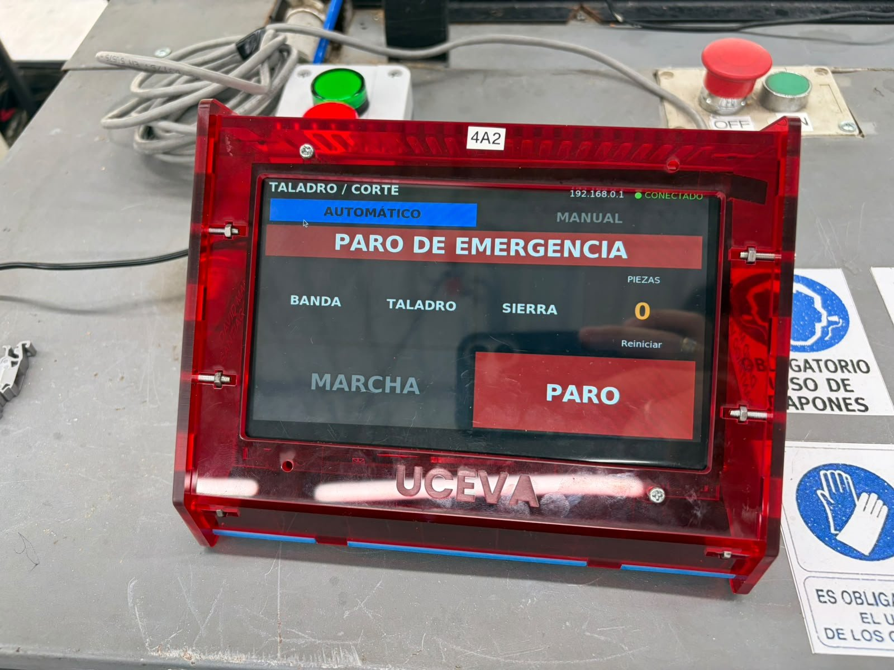
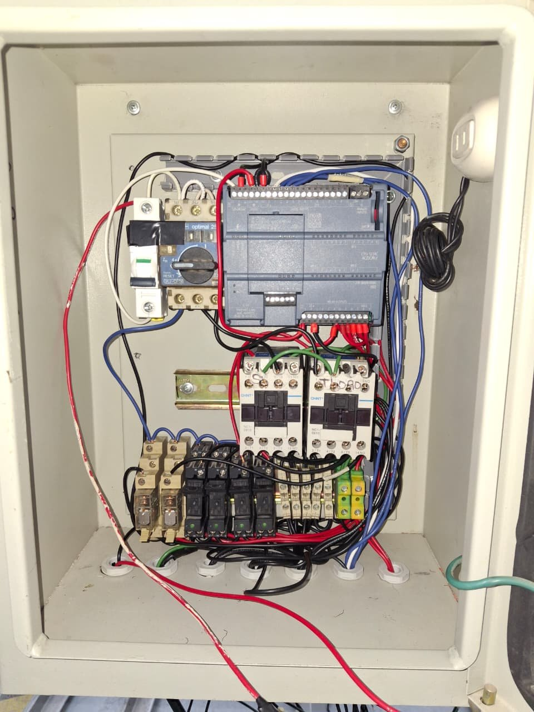
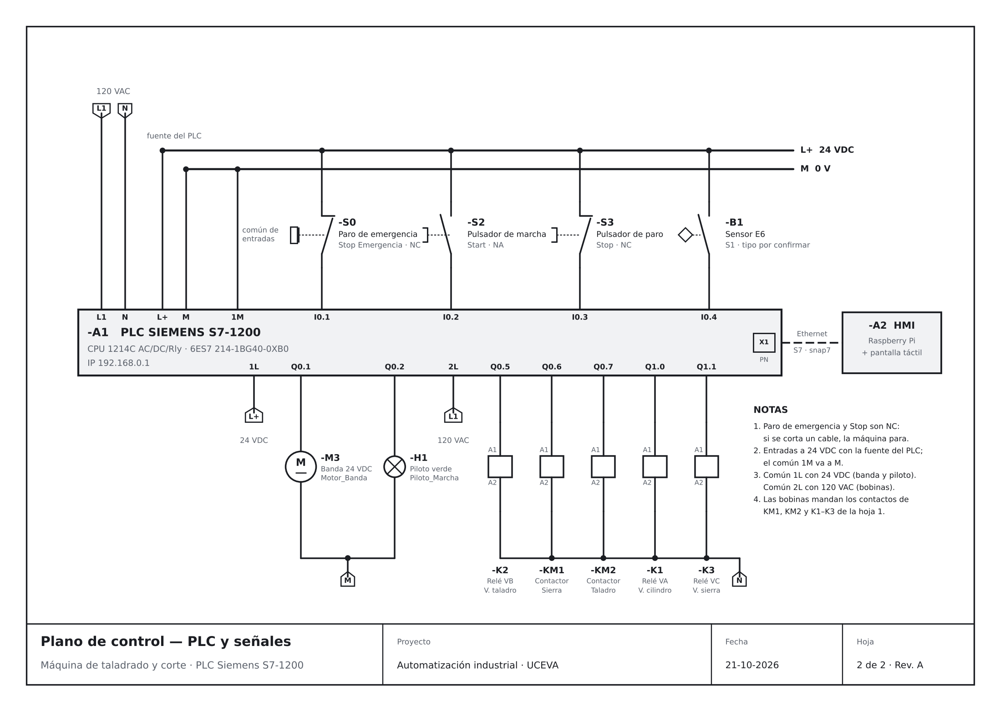

# Automatización de máquina de taladrado y corte con PLC

Automatización de una máquina de taladrado y corte con un **PLC Siemens S7-1200** y una **HMI táctil en Raspberry Pi**. La máquina no tenía pantalla, así que se desarrolló una interfaz que se comunica con el PLC por Ethernet y permite operarla en modo automático y manual.

Proyecto de automatización industrial — Ingeniería Electrónica, Unidad Central del Valle del Cauca (UCEVA), 2026.

<p align="center">
  
  
</p>

## Componentes

| Parte | Detalle |
| --- | --- |
| PLC | Siemens S7-1200 CPU 1214C AC/DC/Rly (6ES7 214-1BG40-0XB0) |
| Programación | TIA Portal V21 (STEP 7 Basic), lenguaje ladder (LAD) |
| HMI | Raspberry Pi con pantalla táctil, Python + Tkinter + python-snap7 |
| Comunicación | Ethernet, protocolo S7 (Raspberry → PLC en 192.168.0.1) |
| Actuadores | Motor del taladro, motor de la sierra, motor de la banda y 3 electroválvulas (cilindro, taladro y sierra) |
| Tablero | Breaker, guardamotor, contactores para los motores, relés para las electroválvulas y paro de emergencia |

## Cómo funciona

**Modo automático**
- Marcha y paro desde la pantalla, con pilotos de banda, taladro y sierra
- Ciclo automático controlado por el PLC con temporizadores
- Contador de piezas con reinicio (pide confirmación con un segundo toque)
- El paro de emergencia físico detiene todo y la HMI lo muestra en pantalla

**Modo manual**
- Mando individual del taladro, la sierra, la banda y las tres electroválvulas
- Solo se puede entrar con la máquina detenida y sin emergencia
- Máximo 3 salidas encendidas a la vez
- **Latido de seguridad:** la HMI envía una señal de "vivo" cada 0,1 s; si deja de llegar, el PLC corta el modo manual

## Entradas y salidas del PLC

| Dirección | Variable | Elemento |
| --- | --- | --- |
| `I0.1` | Stop Emergencia | Paro de emergencia (NC) |
| `I0.2` | Start | Pulsador de marcha (NA) |
| `I0.3` | Stop | Pulsador de paro (NC) |
| `I0.4` | S1 | Sensor E6 |
| `Q0.1` | Motor_Banda | Motor de la banda, 24 VDC |
| `Q0.2` | Piloto_Marcha | Piloto verde |
| `Q0.5` | VB | Relé K2 → electroválvula del taladro |
| `Q0.6` | Sierra | Contactor KM1 → motor de la sierra |
| `Q0.7` | Taladro | Contactor KM2 → motor del taladro |
| `Q1.0` | VA | Relé K1 → electroválvula del cilindro |
| `Q1.1` | VC | Relé K3 → electroválvula de la sierra |

## Mapa de memoria PLC ↔ HMI

| Dirección | Quién escribe | Señales |
| --- | --- | --- |
| `MB10` | Raspberry (pulsos) | `M10.0` Marcha · `M10.1` Paro · `M10.2` Reset conteo · `M10.3` Pedir manual · `M10.4` Salir de manual |
| `MB11` | PLC | `M11.0` Máquina ON · `M11.1` Taladro · `M11.2` Sierra · `M11.3` Emergencia · `M11.4` Modo manual aceptado |
| `MB12` | Raspberry (cada 0,1 s) | `M12.0` Taladro · `M12.1` Sierra · `M12.2` V. cilindro · `M12.3` V. taladro · `M12.4` V. sierra · `M12.5` Banda · `M12.7` Latido |
| `MD14` | PLC | Conteo de piezas (DInt) |

## Planos eléctricos

| Plano | Contenido |
| --- | --- |
| [Fuerza](diagramas/plano_fuerza.pdf) | Breaker, guardamotor, contactores de la sierra y el taladro, y relés de las electroválvulas |
| [Control](diagramas/plano_control.pdf) | PLC 1214C con sus entradas (emergencia, marcha, paro y sensor), salidas a 24 VDC y 120 VAC, y la conexión Ethernet con la HMI |



## Estructura

| Carpeta | Contenido |
| --- | --- |
| [`plc/`](plc) | Proyecto de TIA Portal V21 archivado (`.zap21`). Se abre con **Proyecto → Desarchivar** |
| [`hmi/`](hmi) | Programa de la HMI para la Raspberry Pi |
| [`diagramas/`](diagramas) | Planos de fuerza y de control en PDF y PNG |
| [`docs/`](docs) | Fotos de la HMI y del tablero |

## Cómo ejecutar la HMI

```bash
cd hmi
pip install -r requirements.txt
python3 hmi_taladro.py
```

- Con `SIMULADO = True` (al inicio del archivo) funciona sin PLC, para probarla en cualquier computador.
- Con `SIMULADO = False` se conecta al PLC en la IP de `PLC_IP`. En TIA Portal hay que permitir el acceso **PUT/GET** en la CPU.
- Para salir: tecla `Esc` o mantener presionado el título 3 segundos.

## Autores

- David Felipe Manzano Aldana — [@DavidManzano04](https://github.com/DavidManzano04)
- David Santiago Vallejo Rodríguez — [@Sanvallejo999](https://github.com/Sanvallejo999)
